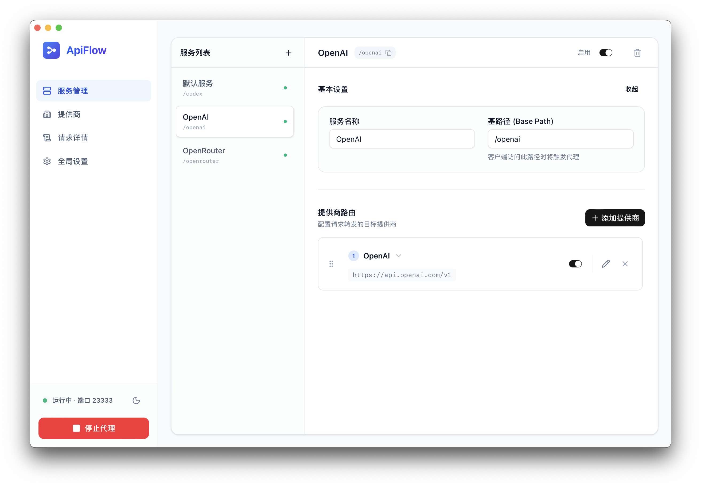
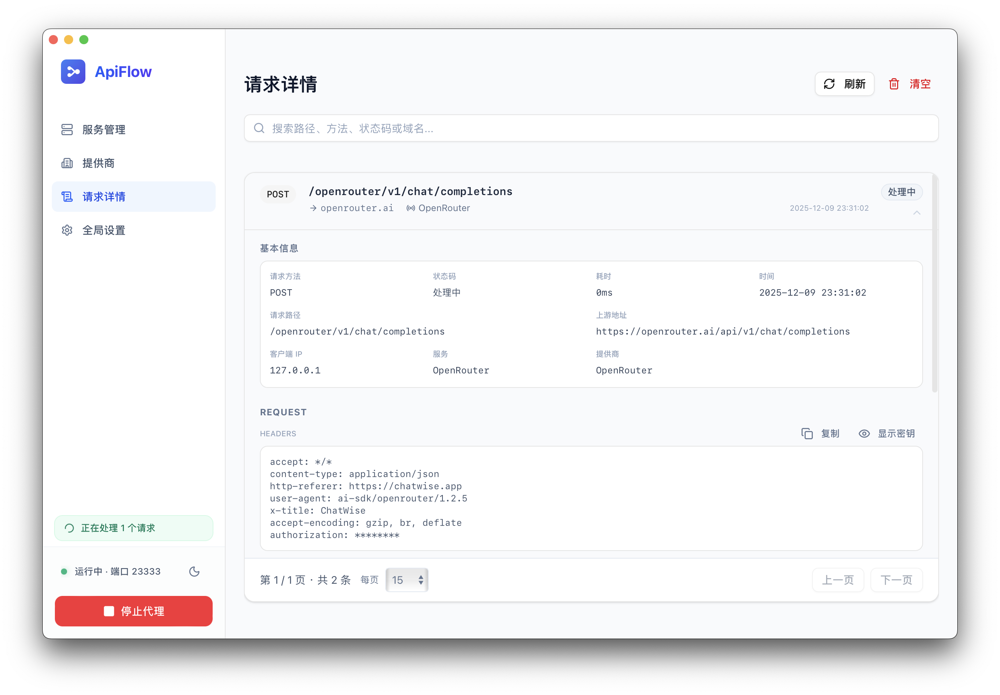
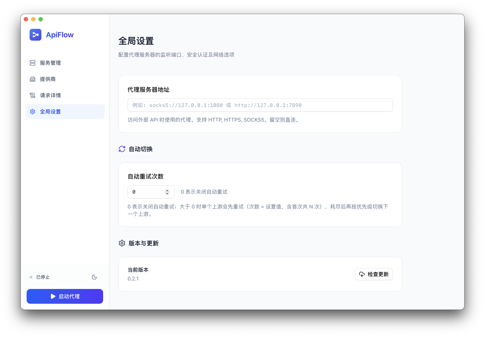

# ApiFlow

ApiFlow 是一款桌面级多上游 API 代理与路由控制台，前端基于 Tauri + React，后端使用 Axum/Reqwest 进行 HTTP 转发。支持流式透传、请求级日志、自动切换与重试，适合集中管理 LLM/AI API。

## 快速获取
- 最新发行版：https://github.com/spoonnotfound/apiflow/releases

## 核心界面
- 服务路由配置  
  
- 请求详情审计  
  
- 全局设置与重试策略  
  

## 功能特性
- 多服务/多提供商路由：按 Base Path 管理服务，灵活映射到不同上游并可调整优先级。
- 流式代理与透传：支持 SSE/流式响应，前后端链路保持实时。
- 自动切换与重试：可配置重试次数，失败后按优先级切换下一个提供商。
- 请求级审计与统计：完整记录方法、路径、上游 URL、状态码、耗时、错误与请求头，支持筛选与详情查看。
- 外部网络代理：支持 HTTP/HTTPS/SOCKS 出口代理，便于访问受限网络。
- 桌面端一键启停：可复制局域网地址/主机名，便捷共享给内网终端。

## 使用流程
1. 打开应用，在“提供商”配置上游 Base URL、API Key（如 OpenAI、OpenRouter 等）。
2. 在“服务管理”创建服务，设置 Base Path，并为其配置目标提供商路由。
3. 在“全局设置”设定代理监听端口、可选的出口代理、自动重试次数等。
4. 点击“启动代理”，确认状态为运行中并记下端口或局域网地址。
5. 将原有调用地址替换为 `http://<主机或局域网地址>:<端口>/<basePath>`，路径保持一致即可。
6. 通过“请求详情”查看实时日志、过滤、复制或导出关键信息。

## 开发者
- 前端调试：`npm install && npm run dev`
- Tauri 调试：`npm run tauri dev`
- 构建发行版：`npm run tauri build`

## 许可证
本项目基于 MIT License 发布，详见 `LICENSE`。
